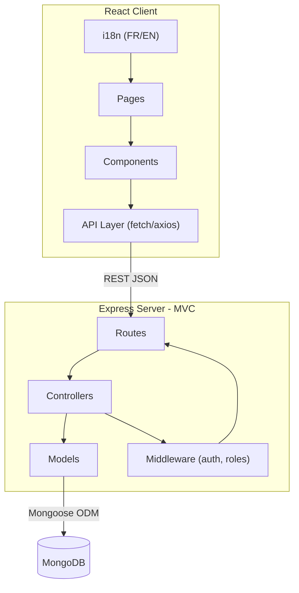

# AwaniShop — Sprint Plan

## Current State

- **Client**: React 19 + Vite + Tailwind 4 + shadcn UI. Sidebar, theme, and routing skeleton exist. No pages are functional.
- **Server**: Express skeleton with broken `index.js` (uses `app` before declaration, ESM imports in a CommonJS project, missing `dotenv`, no routes or controllers). Only a partial `Product` model exists. `db-config.js` doesn't import `mongoose`.
- **Docs**: `PLAN.MD`, `PROGRESS.MD`, `CHAT.MD` are all empty — we fill them as we go.

---

## Architecture



**Server folder structure target:**
```
server/
├── config/
│   └── db.js
├── controllers/
│   ├── auth.controller.js
│   ├── client.controller.js
│   ├── product.controller.js
│   ├── order.controller.js
│   ├── stock.controller.js
│   ├── supplier.controller.js
│   └── category.controller.js
├── middleware/
│   ├── auth.middleware.js
│   └── role.middleware.js
├── models/
│   ├── Client.js
│   ├── Product.js
│   ├── Order.js
│   ├── StockMovement.js
│   ├── Supplier.js
│   ├── Category.js
│   └── Settings.js
├── routes/
│   └── *.routes.js
└── index.js
```

---

## Roles

- **Admin**: full access — CRUD on all modules, settings, stats
- **Cashier**: read clients/products, create and view orders only

---

## The 6 Models (MongoDB/Mongoose)

- **Client**: `fullName`, `phone`, `createdAt`, `loyaltyPoints`, `totalSpent`
- **Product**: `name`, `qrCode`, `buyPrice`, `sellPrice`, `quantity`, `category` (ref), `supplier` (ref)
- **Order**: `client` (ref), `items[]` (`product` ref, `qty`, `unitPrice`, `discount`), `subtotal`, `discountTotal`, `total`, `createdBy`, `createdAt`
- **StockMovement**: `product` (ref), `type` (`in` | `out`), `quantity`, `source` (`order` | `supplier-delivery` | `manual`), `ref`, `date`
- **Supplier**: `name`, `phone`, `email`, `address`
- **Category**: `name` (FR + EN)
- **Settings**: `loyaltyThreshold` (default 1000 DZD), `loyaltyReward` (default 50 DZD)

---

## Sprint 0 — Server Fix + Project Foundation
**Goal**: A clean, running server. Docs initialized.

- Fix `server/index.js`: declare `app` before use, convert to CommonJS (`require`), wire `dotenv`, add `cors`
- Fix `server/config/db.js`: add missing `mongoose` import, switch to CommonJS
- Add missing deps: `dotenv`, `cors`, `nodemon`, `jsonwebtoken`, `bcryptjs`
- Add `dev` script to `server/package.json`
- Create empty route/controller/middleware folders
- Set up `i18next` + `react-i18next` on the client
- Fill `PLAN.MD` with this document
- Update `PROGRESS.MD` after each sprint

---

## Sprint 1 — All 6 Models (Data Layer)
**Goal**: All Mongoose models defined, validated, and connected.

- Write all 7 model files (including `Settings.js`)
- Loyalty logic hook in the `Order` model (post-save middleware: if `order.total >= settings.loyaltyThreshold`, add `settings.loyaltyReward` to `client.loyaltyPoints`)
- Stock auto-deduction hook in the `Order` model (post-save: create `StockMovement` with `type: out` for each item)
- Low-stock alert: field `lowStockThreshold` on `Product` + a utility function that flags products below threshold

---

## Sprint 2 — Full REST API (Controllers + Routes)
**Goal**: Every module has working, tested endpoints.

- `POST /api/auth/login` — returns JWT
- `GET/POST/PUT/DELETE /api/clients`
- `GET/POST/PUT/DELETE /api/products`
- `GET/POST /api/orders` (POST triggers stock deduction + loyalty update)
- `GET /api/orders/:id` (full invoice detail)
- `GET /api/stock/movements` + `GET /api/stock/alerts`
- `GET/POST/PUT/DELETE /api/suppliers`
- `GET/POST/PUT/DELETE /api/categories`
- `GET/PUT /api/settings`
- Auth middleware (JWT verify) + role guard middleware on all protected routes

---

## Sprint 3 — Core: Orders / Invoice Creation (Frontend)
**Goal**: The most important screen — a cashier can make a complete invoice.

This is the heart of the app and should be as simple as possible.

- Order page layout: left = item list, right = client + totals
- Client search (by name or phone) with autocomplete
- Product search (by name or QR code scan input)
- Add item to invoice: quantity + per-item discount field
- Live calculation: `subtotal`, `discount total`, `final total`
- Submit order → success toast → option to print invoice
- Print view: clean printable invoice layout (FR/EN)
- Cashier role restriction enforced

---

## Sprint 4 — Products, Stock, Suppliers, Categories (Frontend)
**Goal**: Admin can manage the full catalog and monitor stock.

- **Products**: data table with search, add/edit modal (QR code field), buy/sell price visible to admin only
- **Stock**: movements table (date, product, type in/out, qty, source) + alert banner for low-stock items
- **Suppliers**: simple CRUD table
- **Categories**: simple CRUD table (name in FR + EN)
- Stock entry form: admin records a supplier delivery (creates `StockMovement` with `type: in`, updates product quantity)

---

## Sprint 5 — Clients, Loyalty, Stats, Auth (Frontend)
**Goal**: Full client management, dashboard, and login.

- **Login page**: already scaffolded — wire it to the auth API, store JWT in `localStorage`, redirect by role
- **Clients**: table + add/edit modal, loyalty points badge, total spent
- **Dashboard (Statistiques)**: revenue chart (last 30 days), top 5 products sold, total clients, low-stock count
- **Settings page** (admin only): configure `loyaltyThreshold` and `loyaltyReward`

---

## Sprint 6 — i18n, Polish, and Hardening
**Goal**: Production-ready, bilingual, accessible.

- Complete FR/EN translations for all labels, toasts, errors
- Language toggle in the sidebar footer
- Form validation everywhere (client-side with `zod`, server-side with schema validation)
- Error boundaries on all pages
- API error handling (no raw errors shown to user)
- Rate limiting on auth endpoint (`express-rate-limit`)
- Final responsive check (tablet-first, since a shop counter often uses a tablet)
- Update `PROGRESS.MD` to complete
